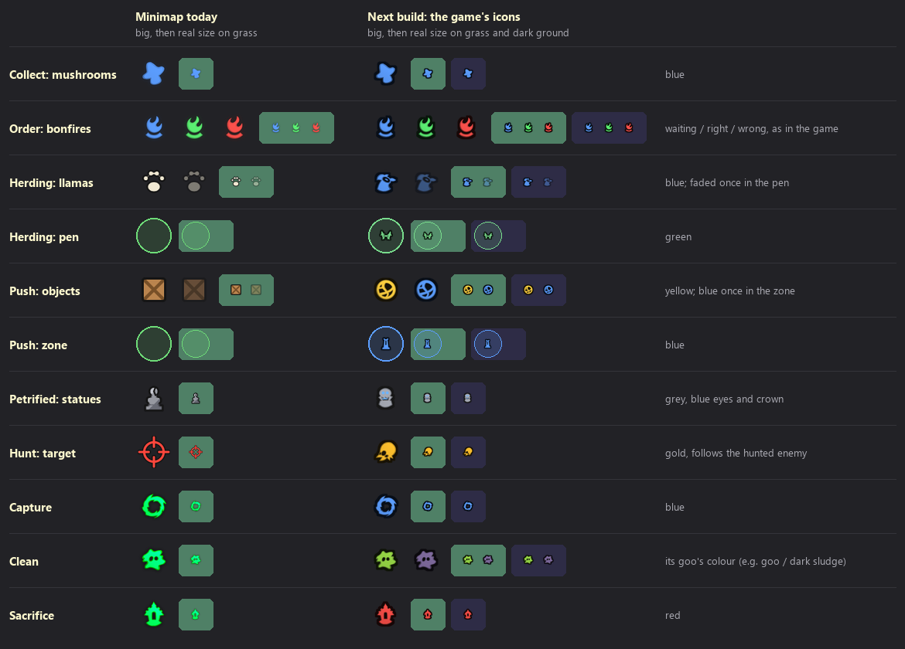

# Spell Brigade Minimap

A round minimap for **The Spell Brigade**, in the corner of the screen during runs and framed like the game's own HUD rings. A BepInEx 6 (IL2CPP) mod.

**Install:** [StrayingFox / Spell Brigade Minimap on Thunderstore](https://thunderstore.io/c/the-spell-brigade/p/StrayingFox/Spell_Brigade_Minimap/) (r2modman or Thunderstore Mod Manager). Current version: **1.2.3**.

The full player guide (everything on the map, keys, config and changelog) is the Thunderstore page's README: [`thunderstore/README.md`](thunderstore/README.md).

## What it shows

- **The level itself** as a pixel picture taken from above as you drop in. Only the arena is drawn, and rocks and walls are solid black.
- **Enemies by rank**: red circles, orange triangles, pink squares (heavy), purple stars (mini-bosses), and a skull for bosses.
- **Objectives and their pieces** with the game's own icons, coloured per objective. Each one only appears once someone in the party has had it on screen, or once the game points at it from the edge of the screen. Discoveries are shared through the host with everyone running the mod.
- **Pickups, teammates (ghosts when dead), geysers, tornadoes and portals**, plus **MoreEvents** targets when that mod is installed.
- It turns with the camera, zooms with `=` and `-`, hides with `M`, and moves out of the way of the game's HUD in its corner.



## Development

### Layout

| Path | What |
|---|---|
| `src/Core` | Plain C# with no Unity: map math, the level picture, sprites drawn in code, icon recolouring, enemy ranks and shapes, discovery sets. Compiled into the plugin and the tests. |
| `src/Plugin` | The BepInEx plugin: scanning the game every frame, the UI, the level mapper, the game's icons and font. |
| `tests/Core.Tests` | Tests for `src/Core` with a small runner (every public static method of a `*Tests` class). |
| `thunderstore/` | The package: `manifest.json`, the player `README.md`, `icon.png`. |
| `tools/` | `make-icon.ps1` (draws `icon.png`), `InteropDump` (lists the game's types and members from the interop DLLs). |
| `docs/superpowers/specs` | The design, with a revision per change and the evidence behind it. |
| `docs/previews` | Pictures of icon and colour choices. |

### Build and test

The plugin builds against the BepInEx core and interop DLLs of the r2modman **Default** profile (`%APPDATA%\r2modmanPlus-local\TheSpellBrigade\profiles\Default\BepInEx`). BepInEx makes the interop DLLs on the game's first start. For another profile or a game-folder install, pass `-p:BepInExDir=...`.

```bash
dotnet build src/Plugin -c Release
```

```bash
dotnet run --project tests/Core.Tests -c Release
```

### Try it in the game

Copy `src/Plugin/bin/Release/net6.0/SpellBrigadeMinimap.dll` into the profile's `BepInEx\plugins\StrayingFox-Spell_Brigade_Minimap\`. With the game running, the DLL is locked: rename it to `..\SpellBrigadeMinimap-<time>.dll.old` first (BepInEx skips `.old` files), copy the new one in, restart the game, and delete the `.old` once the game is closed. The mod logs what it finds to `BepInEx\LogOutput.log`; `[Debug] SaveDebugImages` also saves its pictures and the game icons it read to `BepInEx\minimap-debug`.

The mod reads game objects each frame and patches nothing: broad Harmony patches of game methods crashed the game. A patch, if ever needed, must be on one concrete method that has its own native code.

### Release

1. Set the same version in `thunderstore/manifest.json`, `src/Plugin/Plugin.cs` (`Version`) and `src/Plugin/SpellBrigadeMinimap.csproj` (`<Version>`), and add a line to the changelog at the end of `thunderstore/README.md`.
2. Build the package: `powershell -ExecutionPolicy Bypass -File package.ps1`. It checks the three versions match and writes `dist/SpellBrigadeMinimap-<version>.zip`.
3. Upload the zip at [thunderstore.io/package/create](https://thunderstore.io/package/create/): team **StrayingFox**, community **The Spell Brigade**, category **Mods**.
